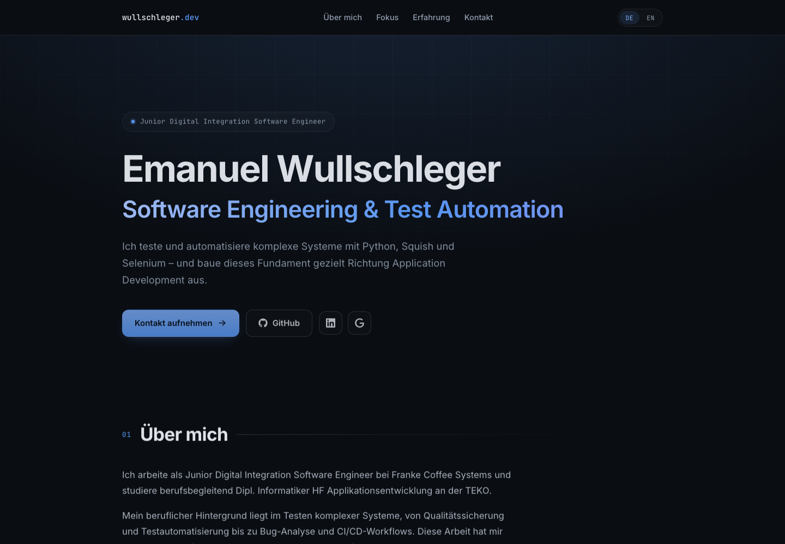

# wullschleger.dev

Personal portfolio of **Emanuel Wullschleger** — Junior Digital Integration Software Engineer with a background in software testing and test automation (Python, Squish, Selenium, Jenkins), currently studying application development (Dipl. Informatiker HF) and growing towards software engineering.

**→ Live site: [wullschleger.dev](https://wullschleger.dev)**



## About this site

Deliberately small — no template, no UI library, no CSS framework.

- **React + Vite**, fully static, hosted on Cloudflare Pages
- **Pre-rendered pages** — every page is rendered to static HTML at build time (a small step in the Vite build, no framework), so it works without JavaScript and has its own meta data and share image
- **Custom CSS** on a small design-token system (colors, spacing, radii, shadows); the app pages add one stylesheet with locally scoped app colours
- **Bilingual** — German (default) and English, each with its own URL (`/`, `/en`, `/apps/…`, `/en/apps/…`); nothing is stored in the browser
- **No third-party requests, no analytics** — fonts (Inter, JetBrains Mono) are served from the site itself; there is no analytics script. Details in the [privacy policy](https://wullschleger.dev/en/apps/ced-buddy/privacy) and [docs/apps/privacy-operations.md](docs/apps/privacy-operations.md)
- **Subtle motion** — CSS entrance animation and IntersectionObserver scroll reveals, disabled for `prefers-reduced-motion`
- **Accessibility basics** — semantic HTML, skip link, visible focus states, ARIA labels

## Structure

```
wullschleger-dev/
├── index.html             page template, start page meta
├── scripts/
│   ├── prerender.mjs      writes static HTML for all pages, 404 and sitemap
│   ├── og/                share image template for the start page (node scripts/og/render.mjs)
│   └── ced-buddy-assets.sh  copies app artwork/screenshots into web sizes
├── public/                static files (CV, app and share images, robots.txt, font licenses)
└── src/
    ├── translations.js    start page text and meta (DE + EN)
    ├── styles.css         design tokens + start page styling
    ├── apps.css           app pages styling
    ├── components/        one React component per section
    ├── apps/              app metadata (apps.js) and app page texts
    └── pages/             app pages (apps overview, product, support, privacy, 404)
```

`npm run build` builds the client bundle, a server bundle for pre-rendering and then runs `scripts/prerender.mjs`. Launch values for apps (status, App Store link) live in `src/apps/apps.js`; see [docs/apps/ced-buddy-launch.md](docs/apps/ced-buddy-launch.md).

## Contact

The best way to reach me is through the [contact section on the site](https://wullschleger.dev/#contact), or on [LinkedIn](https://www.linkedin.com/in/emanuel-wullschleger/).
